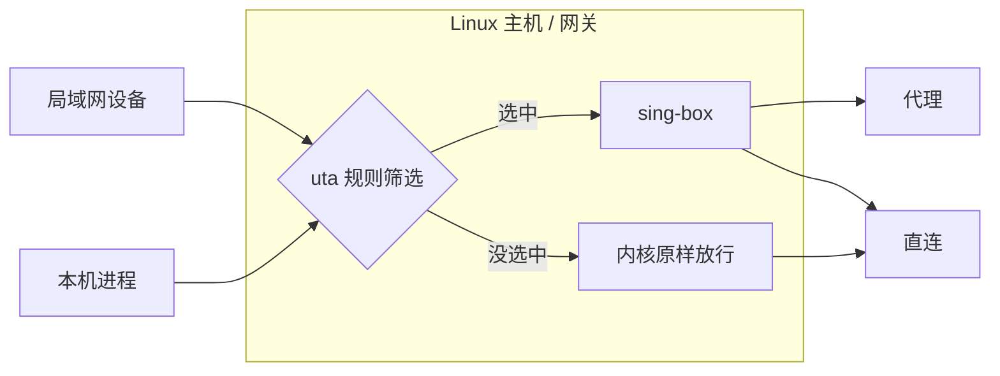

# uta

Linux 上 [sing-box](https://sing-box.sagernet.org/) 的透明代理控制器。适合把一台 Linux 机器变成局域网透明网关，也适合在服务器或本机按规则精确接管流量。

uta 负责把“**接管哪些流量**”和“**流量进来后怎么走**”分开：它通过 nftables 和策略路由，只把规则选中的流量透明地交给 sing-box，没选中的流量由内核原样放行；流量进入 sing-box 之后怎么分流、走哪个出站，全由你自己的 sing-box 配置决定。



## 特点

- **按规则选择接管的流量。** 一行一条，网关侧可按入站网卡、源地址、MAC、目的地址、端口、协议筛选，本机侧可按用户、组、systemd 服务（cgroup）筛选。没选中的流量不经过 sing-box：

  ```
  iif:eth1                                # 局域网的所有设备
  !mac:02:00:5e:10:00:01                  # 这台除外
  !dst:198.51.100.0/24 port:!53           # 这个网段内核直连，但 DNS 照样交给 sing-box
  !iif:eth1 proto:udp sport:41641         # 局域网里 Tailscale 的 UDP 直连
  ```

- **改动要确认才保留。** 改规则或 sing-box 配置会先立即生效，确认后才保留；SSH 断开导致 `uta` 命令退出时立即回滚，无人确认则 90 秒后自动回滚：

  ```console
  $ sudo uta add '!dst:203.0.113.0/24'
  + !dst:203.0.113.0/24
  Keep this change? [y/N] (rolls back in 90s) y
  Confirmed.
  ```

  不在终端里操作时，用 `--pending` 让改动先生效，验证连通后再 `uta confirm`。

- **可以临时接管单条命令。** 不必改常驻规则，用 `uta run` 把单条命令（甚至它依赖的后台服务）临时送进 sing-box，命令结束即恢复：

  ```sh
  uta run curl https://example.com
  uta run --with cgroup:/system.slice/docker.service docker pull alpine
  ```

- **沿用你的 sing-box 配置。** uta 不改动你的分流和出站配置，只在最前面合并一个小片段（见[配置](docs/config.md#uta-加了什么)）。被接管流量的 DNS 默认一起交给 sing-box，也可以保留 systemd-resolved / dnsmasq、由 sing-box 直接替代，或完全不接管 DNS。

- **权限小，退出时清理。** 只需要 `CAP_NET_ADMIN` 和 `CAP_NET_BIND_SERVICE`，不需要 root 运行；由 uta 启动并监管 sing-box，正常退出时清理自己写入内核的规则与路由，路由规则被其他程序删掉时会自动补回。

## 环境要求

- Linux，cgroup v2，nftables（需要 `nft` 命令）。
- systemd：`uta run` 要用它建 scope；仓库附带的服务文件也是 systemd 的。
- sing-box 1.11 及以上（在 1.14 上测试；文档里的示例按 1.12 起的配置格式写）。

在 Ubuntu 24.04（Linux 6.8）和 Arch Linux（Linux 7.3）上测试过。

## 安装

从源码构建：

```sh
git clone https://github.com/AsakuraMizu/uta
cd uta
cargo build --release    # rustup 会按 rust-toolchain.toml 装好所需的 nightly
```

得到 `target/release/uta`。sing-box 从它的 [releases](https://github.com/SagerNet/sing-box/releases) 下载。命令补全的配置见[规则](docs/rules.md#命令补全)。

## 快速开始

下面以**系统服务（透明网关 / 整机）**为例，命令以 root 运行，假设局域网接在 `eth1` 上且已开启 IP 转发。如果只想在个人电脑或服务器上以普通用户身份按需代理，见[以普通用户运行](docs/user-service.md)。

1. 安装 uta 和它的 systemd 服务，建 `uta` 用户：

   ```sh
   install -Dm755 target/release/uta /usr/bin/uta
   install -Dm644 contrib/system/uta.service /etc/systemd/system/uta.service
   install -Dm644 contrib/system/uta.sysusers /etc/sysusers.d/uta.conf
   install -Dm644 contrib/system/uta.toml /etc/uta/uta.toml
   mkdir -p /etc/uta/sing-box
   systemd-sysusers
   ```

   sing-box 放到 `/usr/bin/sing-box`，或者在 `/etc/uta/uta.toml` 里用 `binary` 指定。

2. 写 sing-box 配置 `/etc/uta/sing-box/config.json`。路由规则里的 `hijack-dns` 让被接管的程序直接发给外部 DNS 服务器的查询也由 sing-box 解析，建议保留：

   ```json
   {
     "log": { "level": "info" },
     "dns": {
       "servers": [{ "type": "https", "tag": "remote", "server": "1.1.1.1", "detour": "proxy" }],
       "final": "remote"
     },
     "outbounds": [
       { "type": "socks", "tag": "proxy", "server": "192.0.2.1", "server_port": 1080 },
       { "type": "direct", "tag": "direct" }
     ],
     "route": {
       "rules": [
         { "port": 53, "action": "hijack-dns" }
       ],
       "final": "proxy"
     }
   }
   ```

   确保配置文件对 `uta` 用户可读；如果配置里用到了缓存、证书等需要写入的文件，放到 `/var/lib/uta` 下并写绝对路径（详见[配置](docs/config.md#路径和权限)）。

3. 写规则 `/etc/uta/rules`：

   ```
   iif:eth1
   local
   ```

   第一行接管从局域网进来的流量，第二行把网关自己的流量也交给 sing-box，不需要就去掉。

4. 启动：

   ```sh
   systemctl enable --now uta
   uta status
   ```

之后改规则用 `sudo uta add`、`sudo uta del`，改了 sing-box 配置用 `sudo uta apply`。把自己加入 `uta` 组（`sudo usermod -aG uta $USER`，重新登录后生效），`status`、`apply`、`rollback`，以及确认由 `apply` 发起的改动（`confirm`）就不需要 `sudo` 了；要改 `/etc/uta/rules` 的操作仍然需要 `sudo`，包括 `add`、`del`，以及确认由它们发起的改动。

## 文档

- [规则](docs/rules.md)：规则语法，`add`、`del`、`apply`、`confirm`、`run` 的用法，以及命令补全。
- [配置](docs/config.md)：`uta.toml`、sing-box 配置要注意的地方，以及不用附带的服务文件时怎么部署。
- [DNS](docs/dns.md)：DNS 查询怎么进 sing-box，和系统解析器怎么配合。
- [配方](docs/recipes.md)：网关、本机与通用场景的常见规则写法。
- [以普通用户运行](docs/user-service.md)：作为 systemd 用户服务部署，适合个人电脑或共用服务器。
- [限制与排查](docs/limitations.md)：已知限制、常见报错和排查方式。

## 许可证

MIT 或 Apache-2.0，任选其一。
